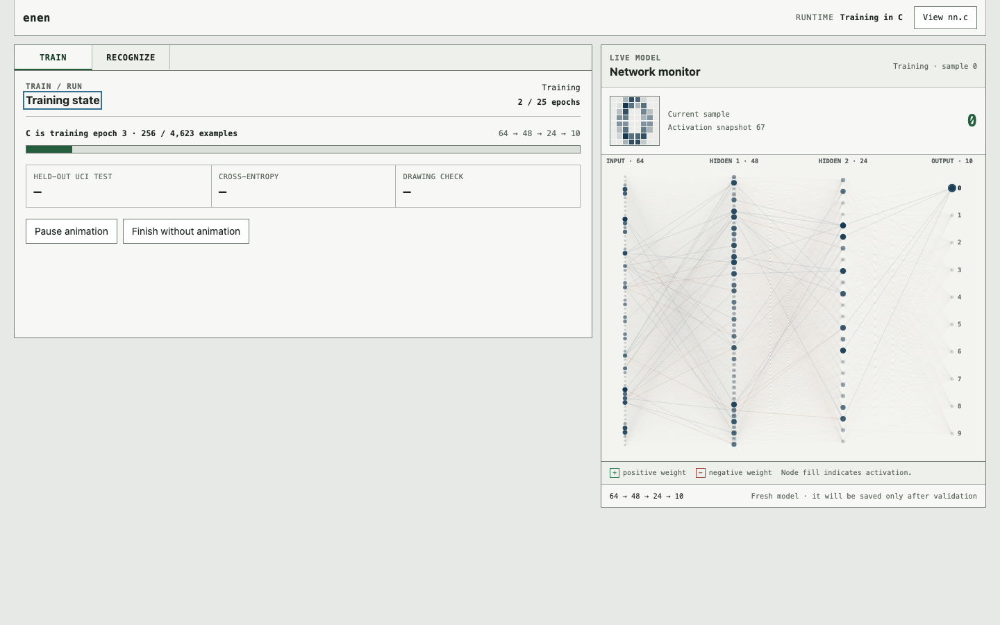
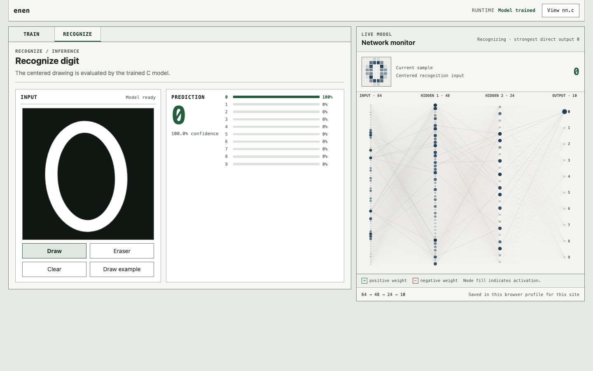

# enen — learning neural networks in C

An educational implementation of a fully connected neural network in plain C.
The aim is to make the path from inputs to predictions—and from a loss back to
weight updates—small enough to read, trace, and experiment with. The network
math lives in [src/nn.c](src/nn.c), with no machine-learning framework behind it.

Handwritten-digit recognition is the demonstration: it gives the network a
concrete task, a reproducible dataset, and a browser interface for watching
training and trying inference. The same C implementation powers the native
programs and the WebAssembly demo.

## See learning and inference

**Training:** the browser updates the C model and displays snapshots of its
actual training examples, activations, and weights.



**Inference:** a trained model predicts a digit from the drawing canvas. The
interface shows class probabilities alongside the network's response.



The prediction card averages C predictions over nearby input variations. The
network monitor shows a direct forward pass of the centered input, so the two
views illustrate different parts of the inference pipeline.
These screenshots show the configurable `64 → 48 → 24 → 10` experiment.

## What the implementation teaches

- **Representation:** layer sizes, flattened weight matrices, biases, and the
  activation and delta buffers needed for learning.
- **Initialization:** Xavier uniform weights and zero biases.
- **Forward propagation:** weighted sums, sigmoid hidden layers, and a stable
  softmax over mutually exclusive output classes.
- **Backpropagation:** the softmax/cross-entropy derivative, the hidden-layer
  chain rule, and why all deltas must be computed before updating weights.
- **Optimization:** shuffled, per-sample stochastic gradient descent (SGD).
- **Evaluation:** accuracy, mean cross-entropy, confusion matrices, and separate
  training, validation, and test responsibilities.
- **Persistence:** saving, validating, loading, and cloning learned parameters.

Start with [the mathematical walkthrough](docs/DIGITS.md), then follow these
parts of the source:

1. [nn.h](src/nn.h) defines the network and its public operations.
2. [nn.c](src/nn.c) implements allocation, forward propagation,
   backpropagation, training, evaluation, and model serialization.
3. [digits.c](src/digits.c) connects that API to a complete training experiment.
4. [test_core.c](tests/test_core.c) checks backpropagation against numerical
   loss derivatives, as well as learning and persistence behavior.

For each training example, the essential learning step is:

```c
forward_pass(inputs[sample], net);
backward_pass(targets[sample], net, learning_rate);
```

Hidden neurons compute `a = sigmoid(b + sum(input * weight))`. At the output,
softmax converts logits into a class distribution. For a one-hot target,
cross-entropy is `-log(p_true)` and its logit derivative is `p - target`.
The code stores the negative gradient, `target - p`, so SGD uses `+=`:

```text
output_delta = target - probability
hidden_delta = activation * (1 - activation) * sum(weight * next_delta)
weight += learning_rate * source_activation * destination_delta
bias   += learning_rate * destination_delta
```

The C core accepts configurable input, hidden-layer, and output sizes. It uses
sigmoid hidden layers and a multiclass softmax output; the browser facade is
specifically configured for the digit demonstration. This is a compact teaching
implementation: extensions such as convolutions, minibatches, regularization,
and adaptive optimizers are left for further experiments.

## Build and run the demonstration

Native requirements: a C11 compiler on a POSIX system such as Linux or macOS,
GNU Make, and the standard math library.

```bash
make all
make check
./build/digits
```

Executables are written to `build/`. The digit demonstration loads
`conf/digits.conf`, trains on the training split, reports held-out test accuracy,
cross-entropy, and a confusion matrix, then saves `models/digits.model`.
Evaluate a saved model without retraining:

```bash
./build/digits --load models/digits.model
```

### Browser laboratory

Serve the included browser artifacts over HTTP:

```bash
python3 -m http.server 8080 --directory webapp
```

Open <http://localhost:8080>. Use **Train** to choose a network shape, learning
rate, and epoch count, then watch the network learn. **Pause animation** freezes
visual updates while C training continues; **Finish without animation** finishes
all selected epochs with larger calls into C. After the model passes the quality
checks, use **Recognize** to draw, erase, and inspect predictions. **View nn.c**
opens the canonical network implementation beside the experiment.

[Emscripten](https://emscripten.org/) is required to rebuild the browser assets:

```bash
make web
```

Rebuild after changing the C core, dataset loader, persistence helper, or browser
facade. `webapp/enen.js` and `webapp/enen.wasm` are generated from those sources;
JavaScript handles the interface and drawing normalization. Forward propagation,
backpropagation, and learned parameters stay in C. See
[webapp/README.md](webapp/README.md) for the browser workflow in detail.

Use HTTP rather than opening `index.html` directly: a `file://` tab cannot fetch
the Wasm module or datasets. Validated models are kept in IndexedDB, local to
the browser profile and site origin, and checked again when restored.

## The digit-recognition use case

Each example is an 8×8 grayscale image with one of ten labels, 0–9. The default
experiment has 17,226 trainable parameters:

```text
64 inputs → 128 sigmoid units → 64 sigmoid units → 10-way softmax
```

The repository includes the official UCI optical-digits split in two forms:

- `datasets/optdigits.tra` and `datasets/optdigits.tes`: 3,823 training and
  1,797 test rows, with integer pixel intensities from 0 through 16.
- `datasets/UCI_digits_train.csv` and `datasets/UCI_digits_test.csv`: the same
  rows with each pixel divided by 16. Every normalized row contains 64 features
  in `[0, 1]`, followed by its integer class label, with no header.

The loader validates every field and produces one-hot targets. Regenerate the
normalized CSVs with:

```bash
./build/convert_optdigits \
  datasets/optdigits.tra datasets/UCI_digits_train.csv \
  datasets/optdigits.tes datasets/UCI_digits_test.csv
```

Conversion rejects input/output aliases, including symbolic and hard links.
Both CSV conversion and model saving use temporary files and atomic replacement
so that a failed write preserves the previous output.

The browser additionally trains on 800 generated drawing variations and checks
160 separate drawing variations before enabling recognition. These pass through
the same centering and normalization used for the live drawing canvas; the
original UCI test split remains outside training.

### Change the experiment

All native programs read `conf/digits.conf`:

```ini
input_size=64
hidden_layers=128,64
output_size=10
learning_rate=0.05
epochs=25
train_dataset=datasets/UCI_digits_train.csv
test_dataset=datasets/UCI_digits_test.csv
```

Each field is required exactly once. Hidden widths, learning rate, and epochs
are useful starting points for experiments; keep dataset dimensions consistent
with the network. Saved models must match the configured input and output sizes.

`accuracy` repeats independently initialized training runs and summarizes their
held-out accuracies. `gym` compares learning rates and epoch counts, reserving
every fifth training row for validation. Candidates share an initialization
and shuffle seed so their settings can be compared fairly.

```bash
./build/accuracy 10
./build/accuracy --load models/digits.model
./build/gym
```

Tuning from a saved model requires a separate normalized validation CSV:

```bash
./build/gym --load models/digits.model --validation path/to/unseen_validation.csv
```

Those examples must have been withheld from **all prior training** of the model.
With explicit validation, candidates fit the full configured training dataset;
`gym` rejects validation examples that overlap configured training or test data,
including copied rows. The model format does not record training history, so
the caller must also ensure independence from any earlier imported data.

## Verification

```bash
make check
make web-check
make browser-check
```

- `check` verifies data loading, numerical gradients, learning, model round trips,
  failed-save recovery, converter safety, validation isolation, and exact CSV
  regeneration. It also runs the native browser-API accuracy gate.
- `web-check` rebuilds and exercises the generated Wasm, checks JavaScript
  syntax, and verifies that the browser's source and dataset copies match the
  canonical files. It requires Emscripten and Node.js.
- `browser-check` exercises startup, training, inference, local model storage,
  recovery, and responsive layouts in Chrome or Chromium. It requires Node.js;
  set `BROWSER` to the browser executable if it is not on `PATH`.

## Deploy the browser demo

The Docker image rebuilds the C/Wasm artifacts and serves static files with
unprivileged Nginx on port 8080. The supplied Compose stack uses the existing
external `proxy` network and publishes no host port:

```bash
docker network inspect proxy
docker compose up -d --build
docker compose ps
```

The supplied Traefik labels serve <https://soto.wiktor.io/enen/> using the
`websecure` entrypoint and `letsencrypt` resolver. They redirect `/enen` to
`/enen/` before stripping the prefix, preserving relative asset URLs. HTTP-to-HTTPS
redirection is assumed to be configured in Traefik. Models remain in visitors'
browser storage, so no server model volume is required.

To deploy from a registry, replace `image: enen:latest` in `compose.yaml` and
omit the `build` block on the server.
